# Horizon Studio

Make mods for [Horizon](https://github.com/horizon-rust/horizon) in Lua, inside the game. Horizon Studio is a
native Horizon mod that adds:

- **A code executor.** A console that runs Lua at once in the running game, like a Lua executor: type
  `player.pos()` and see where you are, or `game.run("time set day")`. `/lua <code>` does the same from chat.
- **Script mods with hot reloading.** A script mod is a script, one `.lua` file in your Horizon folder, or a module,
  a folder of files (main, shared, lib...) that `require` each other. Save any of its files, from the in-game editor
  or any other editor, and it reloads at once: no rebuild, no restart.
- **An in-game editor, laid out like VS Code.** Lua highlighting, suggestions as you type (the whole API, events,
  keywords and your own names, with their signatures and docs), problems found as you type (syntax errors and
  misspelled names, underlined, with their message at the line's end), auto-indent that closes blocks with their
  `end`, brackets and quotes that close themselves, undo and redo, and around the code panes for the script list,
  the console, the problems and an AI agent, which you size and move about as in VS Code.
- **An AI agent in the game.** Ask Claude Code, OpenCode or omp, the one installed on your computer, to write or fix the
  script open in the editor: it sees the file, what you selected and its problems, works through Horizon Studio's
  MCP, and types its changes into the editor as you watch, at a caret of its own. It points at the code it means
  with notes, and teaches with lessons you step through in the editor.
- **A mod library.** Every script mod with its state, error, commands and cost per call. Turn mods on and off,
  reload them, open them in the editor, start a new one from a template, or install one of the bundled examples.
- **Drag and drop install.** Drop a `.lua` file, a mod folder or a `.zip` on the game window and it runs.
- **Docs.** The whole script API, in the game.
- **Themes, and a window of its own.** Seven palettes, an accent of your choice, any size, full screen or a
  Windows 10 style window you drag and size, and four styles after the script executors of old Roblox days
  (Synapse X, ProtoSmasher, its classic look and RC7), each in its own draggable window.
- **Real 3D models.** Textured meshes in the world and on the body: textures from PNG files, base64 or painted
  pixel by pixel, meshes from triangles, from boxes with a skin's UV layout, or from Wavefront `.obj` and Blockbench
  `.bbmodel` files.
- **3D drawing, sounds, particles and screens.** Scripts draw lines, boxes, beams and labels in the world, play
  sounds, spawn particles, and open screens of their own with buttons, toggles, sliders and text fields.
- **Voice chat with Simple Voice Chat servers.** Talk to and hear the players of any server running SVC (the Fabric
  or NeoForge mod, or the Paper plugin), their voices from where they stand: push to talk (or voice activation),
  mute, deafen and the volume in Options → Mods, the microphone and who is talking on the HUD. See
  [Voice chat](#voice-chat).
- **ViaHorizon: join servers of any version.** Like ViaFabricPlus for Fabric: every join goes through
  [ViaProxy](https://github.com/ViaVersion/ViaProxy), which ViaHorizon downloads and runs beside the game, so you can
  play on 1.8, 1.12.2, 1.20 or Beta servers with Horizon's 26.3. You type the server's real address; pick the version
  in Options → Mods → Horizon Studio (or `/via` in game), or leave it on Auto detect.
- **Luau and Roblox scripts.** Luau's syntax (types, `+=`, `continue`, `` `{interpolated}` `` strings, if-expressions)
  and standard library, `task.wait` and `task.spawn` with a scheduler, and Roblox's API on Minecraft: `game`,
  `workspace`, `Instance.new`, `Vector3`, `CFrame`, `UDim2`, signals, TweenService and ScreenGuis drawn in game. A
  Roblox UI script or a general Luau script runs as a script mod; see [Luau and Roblox scripts](#luau-and-roblox-scripts).
- **Libraries.** A mod can export functions for other mods to `import`: a UI library, a pathfinder, a
  shared config. Libraries load first, and mods using one reload with it. Mods send each other events, and
  `gfx.*` draws in Horizon's own style (rounded shapes, the Geist fonts) so a UI library can be written in Lua. The
  bundled **UI Kit** is one, installed with the studio.
- **An MCP server for AI agents.** `horizon-studio-mcp` lets Claude Code, omp, Codex, Cursor and other agents write
  whole mods and libraries, test them end to end (headless, and live in the running game), run Lua in the game and
  read what happened. One line installs and registers it; see [AI agents](#ai-agents-mcp).
- **Natrium: Sodium's and Lithium's ideas for Horizon.** A second native mod in the same bundle: particles off
  screen and terrain hidden in thick fog aren't drawn, the server's ticks skip work that changes nothing, and a
  graphics preset sets Horizon's own options for frame time. It draws and ticks the same as without it, and its
  options are in Video Settings, as Sodium's are in Java's.

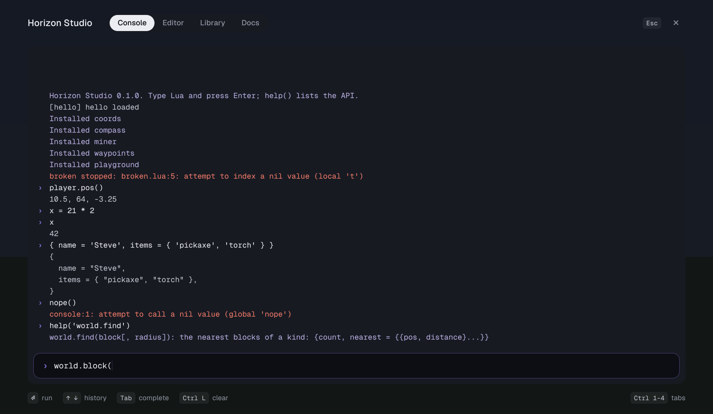

| | |
|---|---|
| 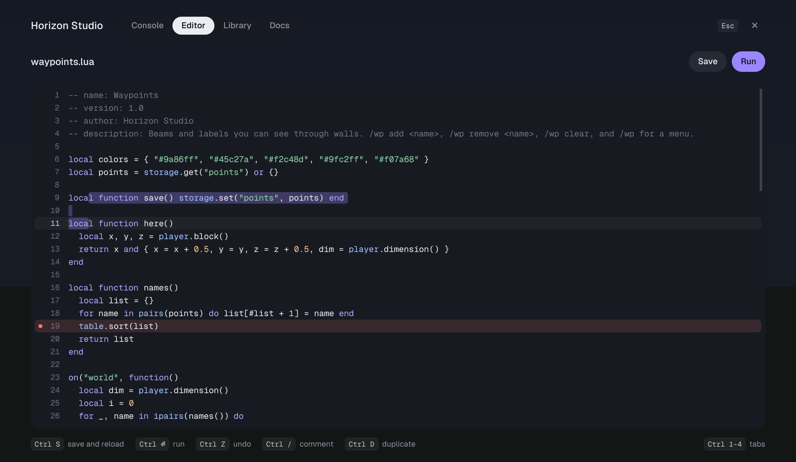 | 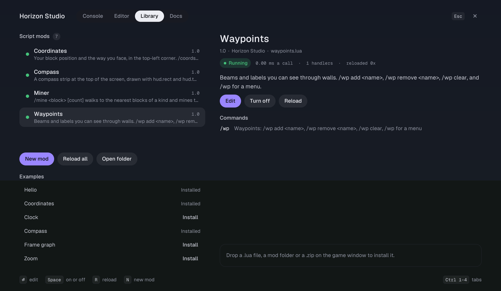 |
| 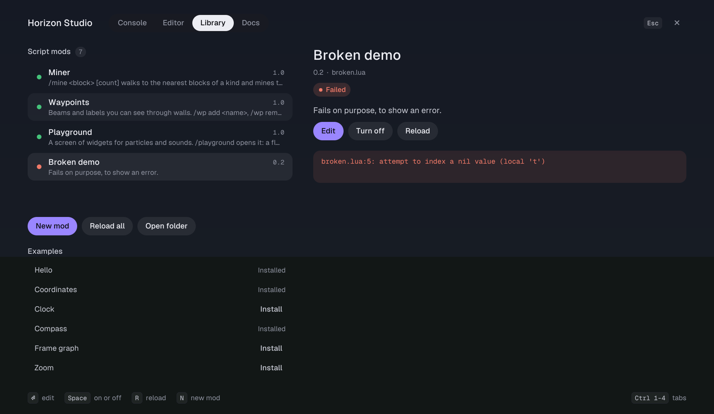 | 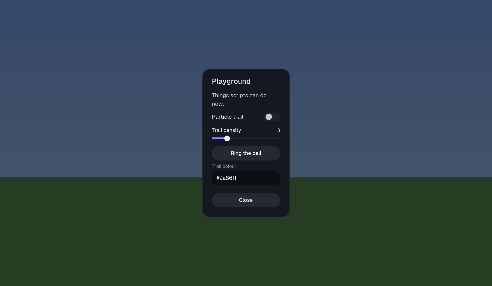 |
| 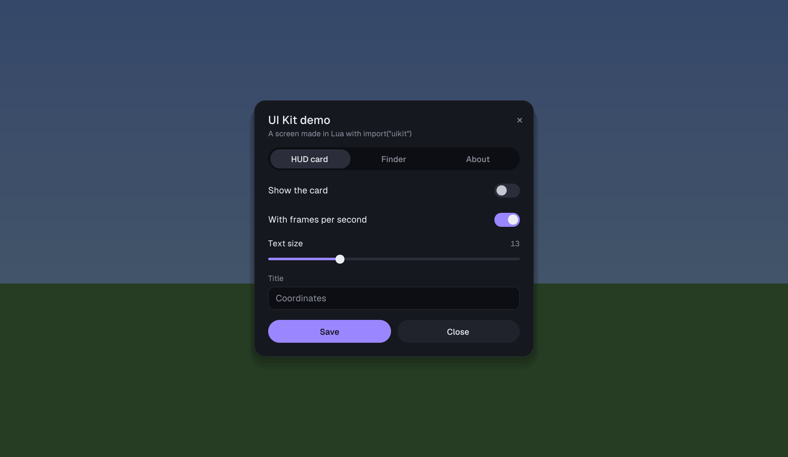 | 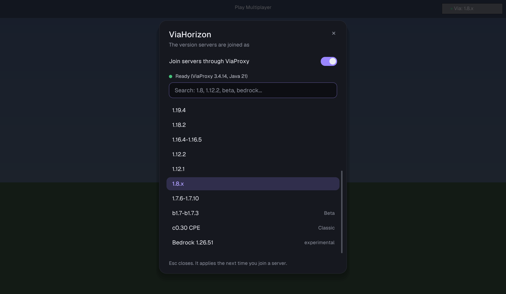 |

The studio draws with Horizon's own design system: Geist and Geist Mono, rounded plates, the dark palette, and its
motion (screens fade and rise in, the tab indicator slides, rows arrive one after another, hovers fade). The pictures
are rendered by `cargo test --test preview -- --ignored` with the game's fonts.

A mod that fails stops alone, with its error and line in the Library, and the rest of the game carries on.
Each call into a script runs under a step budget, so an endless loop stops the script instead of freezing the game.

> Horizon Studio is not made or endorsed by the Horizon project. Like every native mod, it is compiled into your
> game and runs with your rights. Scripts are sandboxed (see [Safety](#safety)); the studio itself is not.

## Install

**Script mods are drag and drop.** Once Horizon Studio is in your game, drop a `.lua` file, a mod folder (with
`main.lua`) or a `.zip` of one onto the game window: it installs and runs at once, and the chat says so. Dropping a
newer version updates it. Copying files into the mods folder (Library → Open folder) works too. Nothing is built.

**Horizon Studio itself needs one build.** Horizon no longer runs drop-in code mods (its WebAssembly mods were
retired), so a mod with code is a [native mod](https://github.com/horizon-rust/horizon/blob/main/docs/native-mods.md)
that the launcher compiles into the game, once. You don't install Rust or type commands: the launcher brings its own
and does it.

On Linux or macOS, one line installs it, and the same line updates it (close the launcher first):

```sh
curl -fsSL https://raw.githubusercontent.com/vermingov/horizon-studio/main/install.sh | sh
```

On Windows, the same in PowerShell:

```powershell
irm https://raw.githubusercontent.com/vermingov/horizon-studio/main/install.ps1 | iex
```

On Linux (x86_64), macOS (Apple silicon) and Windows (x64) this takes seconds: each release carries the game with
Horizon Studio already built in, made the way the launcher makes it, and [install.sh](install.sh) (on Windows
[install.ps1](install.ps1), which does the same steps) puts it where the
launcher keeps its builds (checked against the release's SHA256SUMS) and has the launcher select it. It hands the
launcher the mod as Horizon's registry ships one (`horizon-native.json` beside the bundle), pinning the
horizon-mixins commit the game was built with, so a launcher that updated since names the build as the release
did instead of compiling it again. Elsewhere, or with `HORIZON_STUDIO_BUILD=1`, the launcher compiles it as
before, with settings that compile several times faster (no whole-program optimisation). It finds
`horizon-launcher` on your PATH or in `/Applications/Horizon.app` (on Windows, `horizon-launcher.exe` on your
PATH or in `%LOCALAPPDATA%\Horizon`); set `HORIZON_LAUNCHER` to point at it otherwise, and `HORIZON_LAUNCHER_HOME`
if the launcher keeps its data elsewhere than its default (`%APPDATA%\horizon-launcher` on Windows). Horizon must
be installed and prepared in the launcher first.

Then press **Play** in the launcher: it plays the instance the build was selected for (older launchers make a
**Native mods** instance for it). Or, by hand:

1. `python3 tools/studio.py package` writes `target/horizon_studio-0.7.3.hnmod`.
2. Install it as a native mod in an instance, then **Build** ("I trust these mods: build"). The first build takes 10
   to 30 minutes; later ones are faster. From the command line:
   `horizon-launcher native-build mixins/horizon_studio --trust-native-code`.
3. Play the instance. Options → Mods lists **Horizon Studio**, with its key (F8) to rebind.

Horizon Studio is pinned to one Horizon Nightly (see [How it hooks into Horizon](#how-it-hooks-into-horizon)). All
the native mods of one build must pin the same commit; the launcher tells you when they don't.

## Use it

In a world, press **F8** (or type `/studio`). Escape or F8 closes it. The world keeps running behind it.

| Tab | What it does | Keys |
|---|---|---|
| **Console** | Runs Lua at once. An expression's value is printed, tables expanded. What you register here (`on`, `command`, `every`) runs until `clear()`. Suggestions show as you type. | Enter run · Tab complete · Up/Down history (or choose a suggestion) · Esc close the suggestions · Page Up/Down scroll · Ctrl+L clear |
| **Editor** | Edits a mod's file (or `scratch.lua`), in panes with the script list, the console, the problems and the agent (see [The editor](#the-editor)). Saving reloads the mod. | Ctrl+S save · Ctrl+Enter run in the console (a module's file: save and reload the module) · Ctrl+Space suggest · Tab take a suggestion · drag a tab to move its pane · drag the bars to size panes · right click a tab for its menu · Ctrl+\` or Ctrl+J show, focus or hide the panel · Ctrl+B the script list · the Menu key's Layout › to move and size panes from the keys · Esc back to the code · Ctrl+Z/Y undo/redo · Ctrl+C/X/V · Ctrl+A · Ctrl+D duplicate line · Ctrl+/ comment · Tab/Shift+Tab indent · mouse click and drag · right click or the Menu key: its menu |
| **Library** | Your script mods and the examples, a module with its files; each mod's **...** (or a right click on its row) has its menu: a module's files to open and New file, or a script's Edit, then Reload, Turn off or on, Rename, Duplicate, Make it a module, Delete, Show in folder, Copy path and New mod. Open folder shows the mods folder. | Up/Down choose · Enter edit · Space on/off · R reload · N new script or module · F new file in a module · M make a script a module · . or the Menu key: its menu |
| **Docs** | The API. | Up/Down, Page Up/Down, wheel |
| **Settings** | How the studio looks: see [Themes](#themes-and-the-window). | Up/Down, Page Up/Down, wheel |

Ctrl+1 to Ctrl+5 switch tabs. In chat: `/studio` opens it, `/studio reload` reloads every script mod, `/studio help`
lists the commands the studio takes, and `/lua <code>` runs code and prints the result in chat. These and your mods'
commands are in the chat's suggestions, beside the server's.

### The editor

- **The script list** beside the code has the scratch file, then your mods: a script as one row, a module as a folder
  that a click folds open to its files (opening one of its files unfolds it). A click opens a file, unsaved edits in
  the one before saved first. The **+** in its strip makes a new script or module, or a new file of the module open.
  Each row's **...** (or a right click on it) has its menu (see [Right-click menus](#right-click-menus)): a mod's
  Reload, Turn off or on, Rename, Duplicate, Make it a module and Delete, a module's New file, a file's Rename and
  Delete. A delete asks first and moves the file or mod to `trash/` beside the mods folder (an older copy of the
  same name there stays, as `test (2).lua`), and the editor follows a file that is renamed or made a module.
  Ctrl+Enter on a module's file saves it and reloads the module, since the console can't `require` its files; when
  a module fails in another of its files, a chip on the code's tab strip says where (*Failed in lib.lua:5*) and opens
  it there.
- **Suggestions** open as you type a name: after `player.` the player's functions, after `on("` the events, and
  otherwise the libraries, the standard library, keywords and the names in your file, best matches first. Each shows
  its kind, its signature, and beside the list what it does. Up and Down choose, Tab takes one (Enter too, once you
  have moved through the list), Esc closes them, Ctrl+Space opens them anywhere. A function comes with its brackets,
  the cursor between them; a library with its dot, and its members open. In a module's file they know the other files
  too: `require("` offers them, and after `local lib = require("lib")`, `lib.` offers what lib.lua returns.
- **Problems** are found as you type, a second after you stop typing: a syntax error underlined in red where the parser
  stopped, and in amber a name nothing defines (*nothing defines 'plyer' (did you mean player?)*) or a library
  function that doesn't exist (*player has no 'poss'*). Each line with one has a dot in the gutter and its message at
  the end, the scrollbar marks where they are, and the count by the file's name shows the Problems pane. A runtime
  error still marks its line in red. In a module's file, what the other files define for all of it is known: their
  globals (`_G.x = ` and `getgenv().x = ` set one too), and a member they add to a table as that member alone (their
  `function chat.shout` leaves `chat.sya` a typo; their parameters, loop names and tables' fields, one a line or not,
  are their own). A `require("nope")` of a file the module lacks is marked (*no nope.lua in this module*). The other
  files are read again only when one changes, and in a big module only up to 256 KiB a file, 256 files and 4 MiB in
  all, so typing stays quick; a file past that is still the module's.
- **Typing** keeps your indent, and Enter after `then`, `do`, `function(` or `repeat` indents the next line and
  closes the block below with its `end` (`end)` for a function passed to a call, `until` for `repeat`), unless it is
  already closed. Brackets and quotes close themselves, typing the closing one steps over it, and Backspace between
  an empty pair deletes both. A selection typed over with a bracket or quote is wrapped in it.
- **The panes** are groups, each with a strip of tabs: by default the script list at the left, the code, and under
  it **the panel** (the group holding the console) with the **Console** (the same log and input as the Console tab),
  **Problems** (a click, or Enter, goes to one) and the **Agent**. The code's strip has the file's name and its
  unsaved dot, the problems count, the *Failed in* chip, the notes or lesson chip, and Save and Run; the script
  list's has its +. Drag the bar between two groups to size them: each stops where a pane would be too small to use
  (the code keeps 300 x 140, the console, problems and agent 120 high, two lines and the input). Drag a tab to move
  its pane: a tinted area shows where it lands, among a group's tabs where the pointer is (a bar marks the place),
  beside a group in its outer quarter, among its tabs in its middle, or along the left, right or bottom edge. Where
  there is no room beside a group without pushing another pane out, it joins that group's tabs instead, and the
  tinted area says so before you let go; Esc, or letting go over nothing, cancels. The Console, Library and Docs tabs
  at the top drag in the same way. A strip's × hides its group, in place, and a notice says how it comes back (the
  code's group has none, nor has the script list's, which **Ctrl+B** shows and hides); **Ctrl+\`** or **Ctrl+J**
  shows the panel, wherever it was moved, with its front pane taking the keys, and hides it while it has them.
- **A tab's menu** (a right click on it, or on its strip) has the pane's own items, then Hide, Close (the Library and
  the Docs), Move › (beside the code, with the code or another group, along an edge), Size... (its bars from the
  arrow keys: Shift faster, Tab the next, Enter done), Panes › (every pane: one chosen comes to the front with the
  keys) and Reset layout, which Undo reset layout takes back. The Menu key's menus end with Layout ›, which has the
  same, so the keys alone move and size every pane. The **Library** and the **Docs** dock as panes too, from Panes ›,
  from Dock in the Editor in their own menus or by dragging their tab at the top, and Show in Docs goes to a docked
  Docs, leaving the keys in the code. Where the Editor tab has no room for one, its page opens instead.
- **The keys** go to the pane you click in (its strip's buttons leave them where they are), and Esc gives them back
  to the code; they never reach a pane that isn't drawn, and suggestions stay with the pane they opened in. In a
  small window the pane in use takes the room and a group stacked under or over it keeps its strip, a click away; a
  drop or a pane shown never pushes another out. The layout is kept in `layout.txt` in the studio's folder, written
  at every change.
- **The file on disk** is watched: when something else changes it (another editor, or the agent), the editor reads it
  again, keeping your place, and Ctrl+Z goes back. A change of up to 60 lines is typed in as you watch, as the agent's
  own edits are (with Motion off, or a bigger change, it comes in at once). While you drag a selection (or a bar or a
  tab, or size a pane from the keys), or right after you change the code and save it, it comes in at once whatever its
  size, and your selection and what you see stay where they are. If you had unsaved edits, it asks first: Reload, or
  Keep mine.
  When the script open is made a module elsewhere (the agent's `write_mod`), the editor follows it to its main.lua,
  unsaved edits and all; when the file open is removed, its module's main.lua opens, or, with unsaved edits, it
  stays and asks: Close lets it go, Keep mine keeps it for a save to write back.

### Right-click menus

A right click opens the menu of what is under the pointer, at the pointer: the code, the file's name, the console's
lines and the agent's conversation and their input lines, the rows of the script list and the Library, the examples,
the panes' tabs and strips, the problems, the title bar and the header, and the Docs. The **Menu key** (or
**Shift+F10**) opens the menu of what has the keys: the code's at the cursor, an input line's, the Library's chosen
mod's and the Problems' chosen problem's (the list's own menu while it is empty); on the Editor tab it ends with
Layout ›, where that pane is moved and sized. Up and Down choose (Home and End go to the first and the
last), Enter or Space does it, a letter goes to the next item that starts with it, and Escape, or a click or the wheel
outside it, closes it. A menu taller than the screen scrolls. Items that can't do anything now are greyed out, and
each shows its shortcut.

- **The code**: Go to definition (in the file, or in a module's other files, which it opens and finds it in as they
  are then), Open the library an `import("...")` names or the file a `require("...")` loads, Show the function in the
  Docs; Cut, Copy, Paste, Select all; Toggle comment, Indent, Outdent, Duplicate line; with an agent found, Ask it,
  Explain the selection (or the line), and Fix with it when the line has a problem; Run the selection, Run and Save. A
  right click puts the cursor there, unless that is in the selection, which stays. Go to definition reads the file as
  written, without scopes.
- **The file's name** (and Synapse's tab): Save, Save as a script for scratch code, Revert to saved (one edit: Ctrl+Z
  brings yours back), Rename, Show in folder, Copy path.
- **A mod** (a row of the script list, of Synapse's list, of the Library): Open or Edit (a module's New file and its
  files), Reload (while it is on), Turn off or on, Rename..., Duplicate..., Make it a module, Delete..., Show in
  folder, Copy path, for a mod that failed Copy the error and Fix with the agent, and in the Library New mod. Rename
  gives the mod's file or folder a new id in place: its on/off state and its saved data (`storage/<id>`) go with it,
  and its name in the Library too when it was the old id's (a name written by hand stays); mods that import it fail
  until they import the new id (the prompt says which), and mods that were waiting for the new id start. An id that
  another mod has is refused, whatever its file is called (`My Mod.lua` has the id `my_mod`). A duplicate starts
  turned off, as it would register the same commands twice. Delete asks first and moves the mod to `trash/` in the
  studio's folder, where an older copy of the same name stays, numbered. The lists' empty space offers New script,
  New module, New file in the module open, Reload all and the mods folder; an example offers Install and Copy its
  code.
- **The console's lines** and **the agent's conversation**: Copy what is selected, Copy all, Clear (or Stop and New
  conversation). **Their input lines**: the console's Paste, Copy, Cut and Clear the line, Run and Clear the console;
  the agent's Paste, Clear the line, Send and Stop.
- **A pane's tab or strip**: its own items (Copy all, Clear, Copy all problems, the agents found and Look for agents
  again, Model ›; the file's on the code's tab), then Hide the panel (or the script list, or the group by its tabs),
  Close for the Library and the Docs, Move ›, Size..., Panes › and Reset layout. **A problem**: Go to it, Copy, Fix
  with the agent.
- **The title bar** and **the header**: Roll up, Fill the screen, Reset window, In a window or Full screen, Theme ›,
  Panes ›, Reset layout, Settings, Close. An item ending in › puts its list in the menu's place, so an executor
  style is left in two clicks.

The executor styles have the same menus (ProtoSmasher's theme dropdown lists the themes on a right click); asking the
agent is the studio's own layout's, which has the Agent pane. What a menu did, such as *Copied 42 characters*, shows
at the bottom of the studio a moment.

### The agent

The Agent tab runs the coding agent installed on your computer: **Claude Code** (`claude`), **OpenCode**
(`opencode`) or **omp**, found on your PATH or where their installers put them (on Linux and Windows alike). Set up the MCP server first (see [AI agents](#ai-agents-mcp)), so the agent
has Horizon Studio's tools. Type what you want (*make the waypoints glow at night*, *why does this error?*) and Enter
sends it, with the file open in the editor, what you selected and its problems. The answer, and each tool it uses,
come in as it works, and its edits show in the editor as they land; the next question continues the conversation.
**Stop** ends its work, and the button with its name switches agent when you have several. **Model** chooses the
model it uses: for Claude Code its default, Opus, Sonnet, Haiku or Fable, and for any agent any model by name
(*Other model...*; OpenCode's are `provider/model`, such as `anthropic/claude-sonnet-4-5`); the choice is kept for each agent in `agent-models.txt` in the studio's folder. Drag over its
answers or the console's lines to select them, and Ctrl+C copies them. It can also look at the game: its
`screenshot` tool sees the window as you do, without the studio over it.

**It edits as you watch.** Through Horizon Studio's MCP the agent (the game's own, or one connected from outside the
game) opens any script, reads it as you have it, unsaved edits included, and types its changes in at a caret of its
own with its name on a flag: the code it replaces shows in red a moment, then the new code comes in, in 2 s at most.
Your cursor and selection keep their place, and the view follows the agent until you scroll. Any key or click puts the
rest of its change in at once, so your key lands where you type; Ctrl+Z takes a whole change back, and Ctrl+Y puts it
back. With Motion off, while you are typing, dragging (a selection, a bar or a tab) or sizing a pane from the keys, or
while the code isn't shown (behind another tab, or squeezed to its strip), its changes land at once. It never switches
your file or tab while you use the studio: a change to a file you don't have open is written to disk (the mod
reloads), and a note over the code shows it. A file it opens brings the code to the front without taking your keys,
and never covers the pane you are typing in. Its changes stay unsaved until it saves them or you press Ctrl+S (with
the studio closed they are saved at once, unless the file has unsaved edits of yours); nothing you are typing is saved
for you, and a file changed on disk meanwhile isn't written over. Asking the game's own agent is the one exception:
Enter in the Agent pane, the menus' Ask, Explain and Fix, and a lesson's Check save the file you have open first, so
its turn starts from what you see (the mod reloads with it, half-typed code too). When the game's own agent finishes a
turn well, its unsaved edits are saved; otherwise the Agent pane says they aren't, and how to keep them or take them
back. Each thing it did in the editor has a line in the Agent pane (*Typed lines 12-19 into timer.lua*), and **Show**
on it goes to that code.

**It points at code.** Ask *why does my timer never stop?* and the agent can highlight the lines at fault, in red
for an error (amber for a warning, green for something right, the accent for a note), with a note beside them: the
view goes there unless you are busy, and your cursor stays. The newest note shows in a bubble under its lines; the
others show at the end of their first line, and a click opens them. The bubble's × removes a note, Esc closes the
bubble, and the code's tab strip says how many notes there are (*3 notes*: a click goes to the next, its × clears
them all). Notes stay on their lines as you edit, and one for a file you don't have open waits there; **Show** on
its line in the Agent pane opens it.

The Agent pane's line takes commands too: **/clear** (or /new) starts a new conversation, stopping the agent first if
it is still working (the strip's **New** does the same), **/stop** stops it, **/model** shows or sets its model
(`/model sonnet`, `/model default`) and **/help** lists them. Any other /command (your own Claude Code commands and
skills) goes to the agent as you typed it. While it works, the pane shows for how long.

**It teaches in the editor.** Ask *teach me events* and the agent can give you a lesson: numbered steps over your
code, each a few lines with a note, something to try (*Try: change 20 to 40*) and, in the Agent pane (in the note when
that pane isn't shown), a longer explanation. **Next** and **Back** in the note (or Alt+Right and Alt+Left) go through
the steps, opening another file when a step is in one; **Done** on the last ends the lesson, and so does its ×.
**Check** asks the agent to look at what you did: it reads your code, marks any mistake and tells you how you did (the
game's own agent in the Agent pane, which Check brings back). The code's tab strip shows *Lesson 2/5*. A lesson shows
the Agent pane, unless it would cover the code or the pane you are typing in; while you drag something or size a pane,
it leaves a hidden Agent pane hidden, so nothing moves under the pointer. While the agent waits for you the Agent pane
says *Waiting for you*, and Enter sends it what you write. The executor styles get the same notes and buttons, with
the explanation in the note; there Check is for an agent waiting for you, as they have no Agent pane for the game's
own agent to answer in.

It works in your mods folder and runs with its own permissions: Claude Code may use Horizon Studio's MCP tools and
read files, and asks for nothing else (in a run from the game, anything that needs your approval is refused); omp
runs with `--approval-mode write`, which refuses shell commands; OpenCode runs with its `bash` and `edit` permissions
set to deny (through `OPENCODE_CONFIG_CONTENT`, over your own configuration), so it too works through Horizon
Studio's tools and reads files, but neither runs commands nor edits files itself. To use another agent, put its command line in
`horizon-mods/.horizon-mod-data/horizon_studio/agent.txt` (`{prompt}` where the request goes, or it is sent on its
input; a first line `name: My agent` names it).

### Themes and the window

Settings, the last tab, chooses how the studio looks, and keeps it in `look.txt` in the studio's folder:

- **Theme.** Horizon (the design system's dark), Horizon Light, Midnight, Nord, Rose, Forest and Solar, or one of
  the executor styles below.
- **Window.** Full screen, or a window like a Windows 10 application's: drag it by its title bar, size it from its
  bottom right corner, roll it up to its title bar (—), fill the screen (□) or close it (×). Reset window puts it
  back in the middle. A right click on the title bar (or on the header) has all of these, Theme ›, Panes › and
  Reset layout.
- **Accent**, the colour of the main buttons, the cursor and the selection; **Size**, of everything, 75% to 150%;
  **Backdrop**, how much the studio hides the game; **Code size**, in the editor and console; **Animations** on or
  off.
- **Layout.** Reset layout puts the Editor tab's panes back where they start, and Undo reset layout takes that back.
  The panes' layout is kept in `layout.txt`, beside `look.txt`. Settings itself stays a page, as it restyles the
  whole studio, the panes included.

The executor styles lay the studio out as the script executors of old Roblox days did, each always in its own
window. Only their shape and colours are copied; the window says Horizon Studio, and RC7's letters read HS. Their
layouts are fixed: the panes move in the Horizon themes, and Settings' Reset the panes resets them there.

| Style | Its layout |
|---|---|
| **Synapse X style** | Dark. The editor with its tab and +, the script list on the right (scripts, and modules that fold open to their files; a click opens one), and Execute, Clear, Open File, Execute File, Save File, Console, Options and Attach along the bottom |
| **ProtoSmasher style** | Grey. The editor, then EXECUTE, OPEN FILE, CLEAR and INJECT, the output, then SETTINGS, NEW TAB and the theme's dropdown |
| **ProtoSmasher classic** | A white title bar over a dark body: the editor, Windows' own Execute, Open, Clear and Inject buttons, a grey output, Console and Options |
| **RC7 style** | Maroon, with white tabs down the left (Editor, Console, Library, Docs, Options), a white editor, big letters down the right, and EXECUTE and CLEAR |

Their buttons do the studio's work: Execute runs the editor's code, Clear empties it, Execute File saves the open
file of a mod and reloads the mod, Save File saves it (scratch code as a new script, named first), Open File shows
the Library, Attach and Inject reload every mod, New Tab starts a new script or module, and Options shows Settings.
The console, the Library and the docs show in the editor's place, with their tabs above. In the styles with no
script list, a module's other files open from the Library, from the **...** of the mod chosen there. When a module
fails in another of its files, the chip that says where (*Failed in lib.lua:5*) is beside Synapse's tab and over the
code in the others.

| | |
|---|---|
| 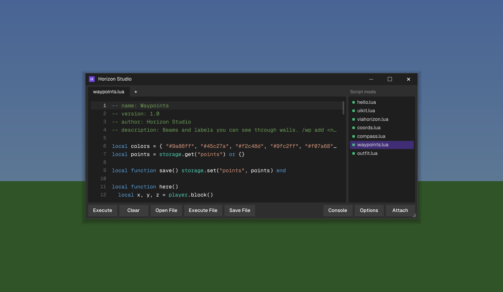 | 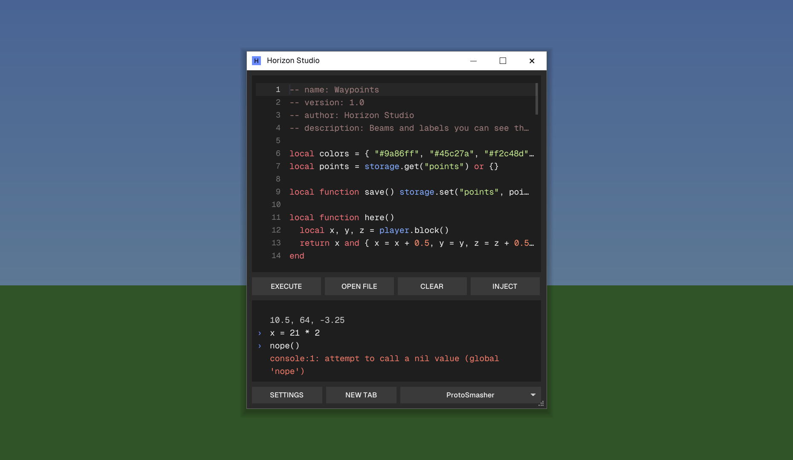 |
| 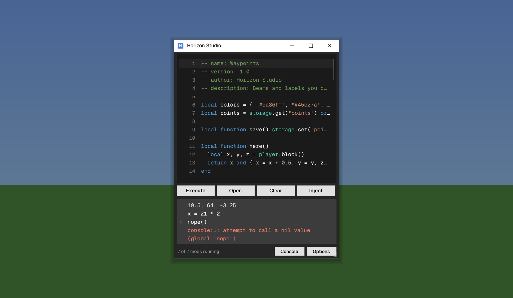 | 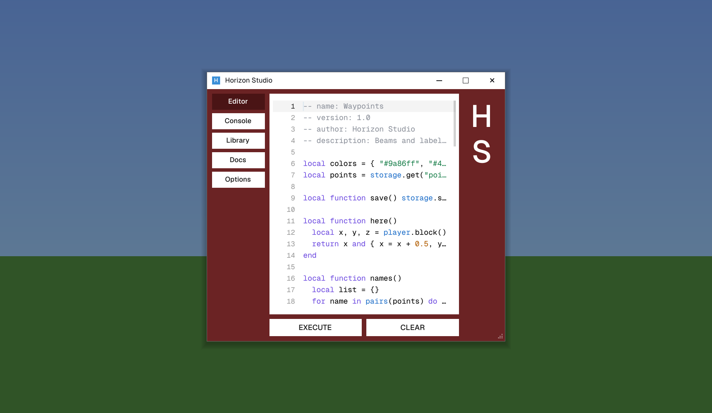 |
| 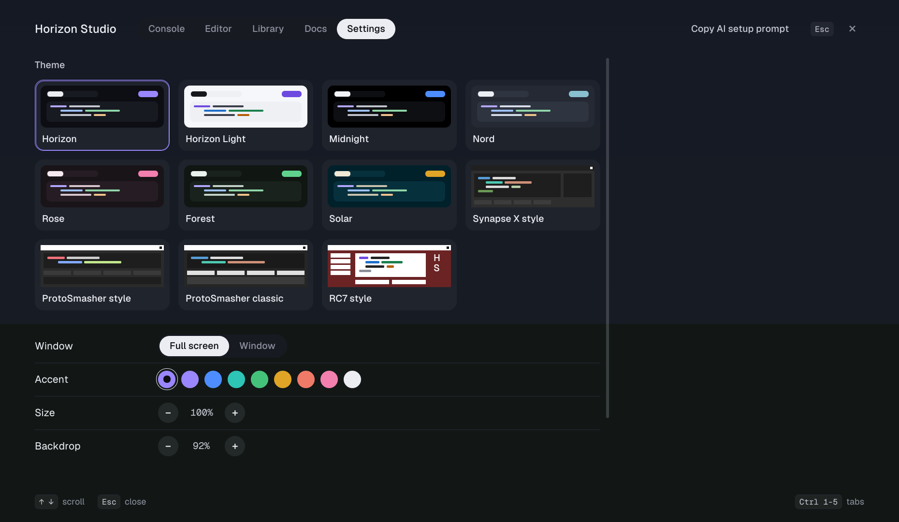 | 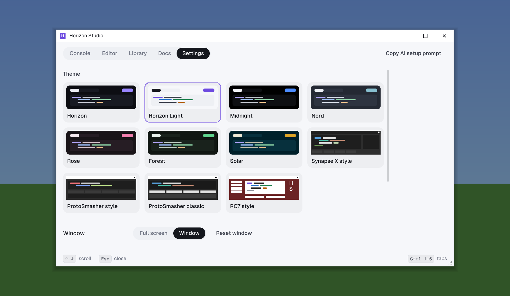 |

## ViaHorizon

ViaHorizon joins servers of other versions as ViaFabricPlus does, with
[ViaProxy](https://github.com/ViaVersion/ViaProxy) doing the translating: Classic, Alpha, Beta, every release from 1.0
to 26.3, and Bedrock (experimental, as in ViaProxy). It is on from the start, set to **Auto detect** (ViaProxy asks
the server its version).

- **Choose the version** with the button in the top right corner of the multiplayer screen (*Via: 1.8.x*, with a dot
  that is green when ViaProxy is ready): it opens the picker, with ViaHorizon's switch, its state, a search field
  (type `1.12`, `beta`, `bedrock`) and every version; click one, or use the arrow keys and Enter. In a world, `/via`
  opens the same list, and `/via 1.8.x` picks one directly. Options → Mods → Horizon Studio has the switch and
  the version too. The choice applies from the next join.
- **Then join as usual**, from the server list or Direct Connection, with the server's own address. The server list
  pings through ViaProxy too when a version is chosen, so it shows those servers as joinable.
- **Online-mode servers** sign in with the account you play with: ViaProxy asks the game (with the
  [OpenAuthMod](https://github.com/ViaVersionAddons/ViaProxyOpenAuthMod) protocol) and the game joins the server's
  session itself, as for any server. Your account's token never leaves the game, and nothing is set up in ViaProxy.
- **The first time**, ViaHorizon downloads ViaProxy 3.4.14 (49 MB, from ViaVersion's Maven repository) and its
  OpenAuthMod plugin (from GitHub), both checked against pinned SHA-256 checksums. ViaProxy needs Java 17 or newer:
  ViaHorizon uses `JAVA_HOME`, the `java` on your PATH, the runtime the Minecraft launcher installed, or a JDK in the
  usual places; with none of these, it downloads Eclipse Temurin 21 (about 50 MB, from Adoptium, checksum verified).
  Everything goes in `horizon-mods/.horizon-mod-data/horizon_studio/viahorizon/`.
- **ViaProxy listens on 127.0.0.1 only**, on a free port, and stops with the game: a small watcher (a shell loop, or
  PowerShell on Windows) ends it when the game's process is gone, even after a crash. It starts when the game does,
  about 3 seconds after Java is ready, so the first join doesn't wait.
- **When it can't start** (no Java and no download), joins with Auto detect go straight to the server; with a
  version chosen, the join says why. The state line on the settings page says what it is doing, and a click retries.
  `/vialog` prints ViaProxy's last lines to the Studio console.

What ViaProxy translates is the protocol: blocks, items, entities, chat, the world. It does not turn Horizon's 26.3
movement and combat into an old version's, as ViaFabricPlus's emulation does inside a Fabric client, so on a 1.8
PvP server you move and hit as in 26.3, which some anticheats notice. Joining as 26.3 skips ViaProxy.

## Voice chat

On a server that runs [Simple Voice Chat](https://github.com/henkelmax/simple-voice-chat) (the Fabric or NeoForge mod,
or the Paper plugin), Horizon Studio talks and listens as SVC's own client does: the other players' voices come from
where they stand, quieter with distance (to the server's voice distance) and from their side, and yours goes to those
near you. Both versions servers run are spoken: 2.6.x (compatibility 20, the stable line) and 2.7.x (21). It asks in 21
first, then in 20 (after the server's "incompatible version" line, or four seconds without an answer), and remembers
which one each server answered in, so the next join asks right away.

- **Push to talk** is the default, on **Caps Lock** (SVC 2.6 and 2.7 leave it unbound until you choose one; Caps Lock is a key
  the game leaves free). **M** mutes the microphone and **N** deafens (SVC's "disable voice chat": nothing heard, nothing sent),
  as SVC's keys. Choose all three in Options → Mods → Horizon Studio.
- **Options → Mods → Horizon Studio** also has its state and settings: push to talk or voice activation, mute,
  deafen, the voices' volume (0 to 300%), the microphone's gain (dB) and voice activation's threshold (dB). They are
  kept in `voice.txt` in the studio's folder.
- **The HUD** shows the microphone (green while it sends), *Muted*, *Deafened* or *Voice chat unavailable* (the
  server has voice chat but it can't connect), and the names of those talking. On a server without voice chat it
  shows nothing.
- **Groups**: their members' voices are heard; `voice.join_group` joins one.
- Scripts have `voice.*` (see [the API](#api)).

The microphone and the speakers are the system's default devices (through cpal). Opus is
[rusty-opus](https://crates.io/crates/rusty-opus) 1.0.2 (BSD-3-Clause), vendored in the voice crate, which decodes as
libopus does (checked against libopus 1.4: its packets decode the same, ours decode in it). The voice packets are
AES-128-GCM with the server's secret, as SVC's.

## Natrium

Natrium does for Horizon what Sodium and Lithium do for Java Minecraft: the same picture and the same game, with
less work a frame and a tick. It comes with Horizon Studio and is on from the start.

As Sodium's options are in Java's video settings, Natrium's are in **Options → Video Settings**: a Natrium section
after Preferences, with its switches as the page's own buttons (Natrium, Particle Culling, Fog Culling, Block Face
Culling, Faster Ticks), Apply Natrium Preset, and what it has skipped so far. The settings search finds them too
(type `culling`). The same switches are on its page in Options → Mods; turning Natrium off there removes the
section.

- **Particle culling.** Horizon builds every particle's quad each frame, behind the camera too (up to 16,384).
  Natrium tests each one against the frame's view first: those outside it cost nothing. Those in view are built
  exactly as Horizon builds them.
- **Fog culling.** Where the fog ends in its own colour, as in the Nether, under water or lava, in powder snow, with
  blindness or darkness, a chunk section wholly past the fog's end is invisible, so it isn't drawn. It never applies
  where the sky shows through (the Overworld's clear air, the End) or with a shader pack.
- **Faster ticks**, as Lithium's: the same work in the same order, with less of it. Item merging looks each
  stack's size up once instead of up to four times per neighbour, and keeps its list of neighbours between items
  (moving drops try to merge every other tick). Villagers looking for items to pick up ask an item where it is before
  what it is, so a village near an item farm no longer costs a tag lookup per villager and item each tick. Swimming
  mobs (fish, squid, drowned) search for paths without a new hash map for every node.
- **The preset** (a button on its page) sets Horizon's own options as their descriptions advise for frame time:
  Entity Culling on (it is off by default), Cave Culling on, and at most 16 chunk updates and 4 MiB of uploads a
  frame, which keeps frames even while chunks load. It changes nothing else and saves with your options.
- **Block face culling** (Sodium's skipping of faces turned away from the camera) is already in Horizon and on by
  default, so Natrium doesn't add it twice: its switch is Horizon's own, as Sodium's Use Block Face Culling is.
  Leave it on; off draws every face, for comparisons.

Each part checks its own switch at the moment it runs, so turning one off takes effect on the next frame or tick. To see what it gains on your machine, compare the FPS counter (F3) with Natrium on and off.

## AI agents (MCP)

`horizon-studio-mcp` is an [MCP](https://modelcontextprotocol.io) server that gives AI agents Horizon Studio: they
write mods (scripts, modules, libraries), check and test them, and drive the running game.

**Give your agent this prompt** and it sets everything up (it installs the server, checks Horizon Studio is in your
game, and tells you when to restart it):

```text
Set up Horizon Studio's MCP server so you can make and test Horizon mods for me. Read
https://raw.githubusercontent.com/vermingov/horizon-studio/main/AI_SETUP.md (with curl if you can't open web pages)
and follow it step by step: run the commands yourself, ask me before building anything into my game, and tell me
when to restart you.
```

In the game, the prompt is a click away: F8 opens the studio, and **Copy AI setup prompt** at its top right copies it
(so does the button in Options → Mods → Horizon Studio). Once an agent is connected, its name shows there instead
(*Claude Code connected*), and on that settings page.

**Or install it yourself**, on Linux or macOS:

```sh
curl -fsSL https://raw.githubusercontent.com/vermingov/horizon-studio/main/mcp/install.sh | sh
```

and on Windows, in PowerShell:

```powershell
irm https://raw.githubusercontent.com/vermingov/horizon-studio/main/mcp/install.ps1 | iex
```

It downloads the program for your machine from the latest release (checked against its SHA-256 sums), puts it in
`~/.local/bin` (`%LOCALAPPDATA%\horizon-studio\bin`), and registers it with the agents it finds: Claude Code (user
scope, through `claude mcp add`), omp (`~/.omp/agent/mcp.json`), Codex, Cursor, Gemini CLI, Claude Desktop and
OpenCode, keeping their other settings. Run it again to update; `horizon-studio-mcp uninstall` takes it out again. Any
other client: a stdio server running `horizon-studio-mcp` with no arguments (`horizon-studio-mcp install --print`
shows the JSON). Then restart the agent.

| Tool | What it does |
|---|---|
| `docs`, `examples` | The complete reference, so an agent never looks elsewhere: every function, event, widget and standard library function with its arguments, results, errors and an example, the language, limits, error messages and fixes, recipes and the test steps; by topic, by exact name (`player.pos`, `event:tick`) or by search, and as MCP resources (`horizon-studio://docs/<topic>`). The server fetches the newest reference from this repository's main branch (`docs/reference.json`) as it starts, so the docs change without a new release. The bundled mods' source |
| `update_server` | Updates the server to the newest release in place; it switches to the new binary at its next call, without a restart or a reinstall (also Options → Mods → Horizon Studio in the game, and `horizon-studio-mcp update`) |
| `write_mod`, `read_mod`, `list_mods`, `delete_mod` | Mods in the game's mods folder, scripts and modules; `write_mod` checks the mod first and reloads it in the game, and for a module writes only the files given (`remove` deletes files) |
| `check_mod` | Loads a mod headless: does it run, its error with its file and line, its commands, handlers and libraries |
| `test_mod` | Steps (commands, chat, keys, Lua assertions, player and blocks, screen clicks...) with expectations (chat, output, text drawn, sounds, particles, mod state), headless or `live` |
| `game_status`, `run_lua`, `send_chat`, `game_log`, `reload_mod` | The running game: its state and mods, Lua in the console, chat and commands, the console log |
| `open_script`, `read_script`, `edit_script`, `save_script` | The player's editor, live: open any script, read it as they have it (unsaved edits too, numbered as edits count lines), type a change in as they watch (one undo step; a file that isn't open is written to disk instead), save it and say how the mod runs |
| `mark_lines`, `clear_marks` | Point at code in the player's editor: lines highlighted in a colour with a note, which stay on their lines as the code changes |
| `start_lesson`, `wait_for_player` | Teach in the player's editor: numbered steps they go through with Next and Back, with tasks to try; what they do (Check, a step, a message from the Agent pane), as it happens |
| `horizon_ctl` | Horizon's own `horizon-ctl` commands for a game started with `--control`: playing it, its widgets, screenshots |

**Headless** tests run the studio itself (the interpreter, events, commands, timers, libraries, screens) on a
simulated game: a player in a world of the blocks a test sets, 20 ticks a second, with a record of everything the mods
print, send, draw, play and spawn. They need no game, so an agent can iterate fast. **Live** tests run the same steps in
the game, through the studio's AI link.

**The AI link.** While Horizon runs with the studio, it listens on `127.0.0.1` (a free port) for the MCP server. The
port and a random token are in `~/.horizon-studio/link.json`, which only your user can read; a client must send the
token first. Through it an agent can do what a script mod or the console can (the same sandbox), and reload mods. It
is on by default; Options → Mods → Horizon Studio → AI link (MCP) turns it off. The MCP server keeps its link open
while both run, so an agent shows as connected from the start of its session.

## Write a script mod

Script mods live in `horizon-mods/.horizon-mod-data/horizon_studio/mods/` in your Horizon game folder:

- `name.lua`: a **script**, a mod in one file, or
- `name/main.lua`: a **module** (a folder mod), whose main.lua loads its other files with `require("file")`
  (`require("lib.util")` reads `lib/util.lua`). Each file runs once, however its name is written, and the files share
  the mod's globals. Two files that require each other while they load are an error that names them.

The file runs when the mod loads, and again each time it changes (for a module, when any of its files does). Lines
at the top name it in the Library:

```lua
-- name: Coordinates
-- version: 1.0
-- author: you
-- description: Your position in the top-left corner. /coords hides it.

local shown = storage.get("shown") ~= false

on("tick", function()
  local x, y, z = player.block()
  if shown and x then
    hud.panel("top-left", { string.format("XYZ %d / %d / %d", x, y, z), "Facing " .. player.facing() })
  else
    hud.panel(nil)
  end
end)

command("coords", function()
  shown = not shown
  storage.set("shown", shown)
  return shown and "Coordinates shown" or "Coordinates hidden"
end, "Shows or hides the coordinates")
```

The Library's **New mod** (or the script list's **+**) writes a file like this to start from. Its **Module** switch
makes a module instead, three files that show how the pieces fit: `main.lua` starts it and requires the other two,
`shared.lua` returns one table every file gets (the values they share), and `lib.lua` returns the functions:

```lua
-- night_light/main.lua
local shared = require("shared")
local lib = require("lib")
command("night_light", function(args)
  return lib.greet(args ~= "" and args or "you")
end, "Says hello")
on("tick", function() shared.ticks = shared.ticks + 1 end)
```

```lua
-- night_light/lib.lua (shared.lua is: return { greeting = "Hello", ticks = 0 })
local shared = require("shared")
local lib = {}
function lib.greet(name)
  return shared.greeting .. ", " .. name .. "! (" .. shared.ticks .. " ticks so far)"
end
return lib
```

In Roblox's style, each file of a module is also a ModuleScript under `script`: `require(script.lib)` in main.lua, and
`require(script.Parent.shared)` in lib.lua, load the same files.

### Events

`on(event, fn)` registers a handler; a mod may have up to 256.

| Event | When | Arguments |
|---|---|---|
| `tick` | each game tick in a world (20 a second) | |
| `frame` | each frame | seconds since the last frame |
| `hud` | each frame the HUD draws (not under F1): where `hud.text` and `hud.rect` draw | GUI width, height |
| `world` | each frame the world draws: the only place `draw.*` draws | |
| `key` | a key or mouse button goes down or up | `"key.keyboard.r"`, `"key.mouse.left"`; `true` when down |
| `chat` | a chat line arrives from the server | its text |
| `unload` | before the mod reloads or turns off | |
| `"name:event"` | another mod (or this one) called `emit("name:event", ...)`, the next frame | what it passed |

### API

| Function | What it does |
|---|---|
| `on(event, fn)` | Runs `fn` on an event (above). |
| `command(name, fn[, help \| options])` | `/name args` calls `fn(args, words)`; a returned string shows in chat. The chat lists, colours and completes it as the server's commands; `options` declares its arguments and their completions ([Commands in the chat](#commands-in-the-chat)). Vanilla's command names are refused. |
| `after(seconds, fn)`, `every(seconds, fn)`, `cancel(id)` | Timers; `after` and `every` return an id. |
| `require(name)` | Loads another file of a module, once (`require(script.lib)` too). |
| `task.wait([seconds])`, `task.spawn(fn, ...)`, `task.defer(fn, ...)`, `task.delay(seconds, fn, ...)`, `task.cancel(thread)` | Luau's task scheduler: wait without stopping the game (a mod's top level, commands, these threads and Roblox signal handlers can wait), and threads of their own now, after the current code, or later. `task.synchronize()` and `task.desynchronize()` do nothing. |
| `wait([seconds])`, `spawn(fn)`, `delay(seconds, fn)`, `tick()`, `time()`, `warn(...)` | Roblox's older globals: `task.wait`, `task.defer` and `task.delay` as they were; seconds since 1970; the studio's clock; a warning in the console. |
| `color(r, g, b[, a])` | A color number for `hud` functions. Colors are also `0xAARRGGBB` numbers or `"#rrggbb"` strings. |
| `print(...)` | A line in the Studio console, after the mod's id. |
| `chat.show(text)` | A line in your chat that only you see. |
| `chat.say(text)` | Sends a chat message. |
| `game.run(command)` | Runs a command as you: `game.run("time set day")`. `chat.say` and `game.run` are limited to a burst of 8, then 4 a second. |
| `game.fps()` | Frames per second, the slowest frame, the 1% low. |
| `game.screen()` | `"playing"`, `"chat"`, `"inventory"`, `"paused"`... |
| `game.time()`, `game.ticks()` | Seconds since the studio started; game ticks so far. |
| `player.pos()`, `player.block()`, `player.look()` | Position; the block position; yaw and pitch. `nil` outside a world. |
| `player.facing()`, `player.dimension()` | `"north"`...; `"minecraft:overworld"`... |
| `player.health()`, `player.food()`, `player.held()` | Health and max; food and saturation; the held item's id and count. |
| `player.info()` | All of these in a table, with `level`, `mode` and `slot`. |
| `player.pose()`, `player.camera()` | `{pose = "standing"\|"crouching"\|"swimming"\|"gliding"\|"spin_attack"\|"sleeping", crouching, swimming, gliding, sleeping, sprinting, on_ground, flying, camera}`; the view: `"first"`, `"third_back"` or `"third_front"` (F5). |
| `player.part(name[, target])` | Where a body part is this frame, as it moves and animates: `{x, y, z, left = {x, y, z}, up = {...}, forward = {...}}`, axes a block long (a model pixel is 1/16 of one); of the player, or of an entity by id. |
| `world.block(x, y, z)` | The block's id, `nil` where nothing is loaded. |
| `world.time()` | Time of day (0 to 23999), game time in ticks, the day number. |
| `world.find(block[, radius])` | The nearest loaded blocks of a kind: `{count = n, nearest = {{pos = {x, y, z}, distance = d}, ...}}`. |
| `world.entities([radius[, type]])` | Mobs, items and orbs near you, nearest first. |
| `hud.panel(corner, lines)` | A box of text in `"top-left"`, `"top-right"`, `"bottom-left"` or `"bottom-right"`, stacked with the game's own; `hud.panel(nil)` removes it. |
| `hud.text(x, y, text[, color[, shadow]])`, `hud.rect(x, y, w, h[, color])` | Draw, inside `on("hud")`. |
| `hud.width(text)`, `hud.size()` | A text's width; the GUI's size, in GUI pixels. |
| `keys.down(key)` | Whether a key is held (`"key.keyboard.r"`). |
| `keys.mapping(name)` | A vanilla mapping (`"key.jump"`): held, and its key's label. |
| `view.zoom(factor)` | Zooms the view, 1 (off) to 10. |
| `draw.line(x1, y1, z1, x2, y2, z2[, color[, width[, through]]])` | A line in the world, inside `on("world")`. `width` is in blocks (0.04). Shapes are solid and hidden behind blocks; with `through` = `true` they show through walls. |
| `draw.box(x1, y1, z1, x2, y2, z2[, color[, width[, through]]])`, `draw.block(x, y, z[, color[, width[, through]]])` | A box's outline; a block's outline. |
| `draw.fill(x1, y1, z1, x2, y2, z2[, color])` | A solid box. |
| `draw.beam(x, z[, color[, width[, y1[, y2]]]])` | A vertical beam (from y -64 to 320 unless given), like a waypoint's. |
| `draw.text(x, y, z, text[, color[, distance]])` | A label at a place, seen through walls; `distance` = `true` adds how far it is. |
| `draw.item(id, x, y, z[, opts])` | An item (or block) as a 3D model at a place, lit by the world; `opts`: `yaw`, `pitch`, `roll` (degrees), `scale`, `display` (`"fixed"`, `"ground"`, `"gui"`, `"head"`, `"hand"`), `glow`. |
| `model.attach(part, spec)` | A model that follows a body part as it moves and animates, drawn every frame until removed (or the mod reloads); returns its id. `part`: `root`, `head`, `body`, `right_arm`, `left_arm`, `right_leg`, `left_leg` (or `hat`, `jacket`, the sleeves and pants). `spec`: `item` (worn on the head or held in a hand where the game puts them) and/or `boxes = {{from = {x, y, z}, to = {x, y, z}, color = "#rrggbb"}, ...}`, in pixels from the part's pivot (x to its right, y up, z forward); `mesh` (a textured mesh, below); `offset`, `rotation = {pitch, yaw, roll}`, `scale`, `display`, `glow`, `first_person` (shown in first person too; the body isn't), `visible`, `target` (an entity id instead of the player). See the Outfit example. |
| `texture.load(file)`, `texture.decode(data)`, `texture.create(w, h[, color])` | A texture (at most 512 pixels a side): a PNG file of a folder mod, a PNG as base64 text (or bytes), or a blank one; returns its id (and size). |
| `texture.set(id, x, y, color)`, `texture.get(id, x, y)`, `texture.fill(id, x, y, w, h, color)`, `texture.paint(id, rows, palette[, x, y])`, `texture.size(id)`, `texture.free(id)` | Pixels, `x`, `y` from 0 at the top left; `paint` sets them from rows of characters looked up in a palette (pixel art as text). |
| `mesh.new(spec)` | A mesh in pixels (16 to a block), facing +z: `vertices`, `uvs` and `faces` (triangles or polygons), and/or `boxes` textured with a skin's box UV (`uv = {u, v}`) or a rectangle per face; `texture`, `color`. |
| `mesh.load(file[, opts])`, `mesh.parse(text, format[, opts])` | A mesh from a Wavefront `.obj` (in blocks; `scale`, `texture`, `color`) or a Blockbench `.bbmodel` (cubes, meshes, groups and its embedded textures; turned to face +z unless `flip = false`), from a folder mod's file or from text. |
| `mesh.info(id)`, `mesh.free(id)` | A mesh's triangles, size and textures; dropping it. |
| `draw.mesh(id, x, y, z[, opts])` | A mesh at a place for this frame (inside `on("world")`), lit by the world: `yaw` (as `player.look()` gives it), `pitch`, `roll`, `scale`, `color` (a tint), `texture`, `glow`. Each triangle counts toward the frame's 16384 shapes. |
| `draw.triangle(x1, y1, z1, x2, y2, z2, x3, y3, z3[, color])` | A filled triangle in the world. |
| `model.set(id, spec)`, `model.remove(id)`, `model.clear()`, `model.list()` | Change the fields given (`item = false`, `boxes = false` remove them); remove one; remove all; this mod's models. |
| `sound.play(id[, volume[, pitch]])`, `sound.at(id, x, y, z[, volume[, pitch]])` | A sound event (`"entity.experience_orb.pickup"`, `"minecraft:block.bell.use"`): for you, or from a place. |
| `world.particle(id, x, y, z[, dx, dy, dz[, count[, color]]])` | Particles (`"flame"`, `"heart"`, `"note"`, `"dust"` with a color...): `dx dy dz` is their speed, `count` up to 64 scattered around the point. Particles that need a block or an item aren't offered. |
| `ui.open(screen)`, `ui.close()`, `ui.is_open()` | A screen of the mod's own: see [Screens](#screens). |
| `agent.query(cmd)` | An instant read from Horizon's agent control: `"state"`, `"inventory"`, `"looking-at"`, `"block X Y Z"`, `"blocks ..."`, `"screen"`, `"messages"`, as a table. |
| `agent.run(cmd[, fn])` | An agent action, `fn(result, err)` when it is done: `"goto X Y Z --near 2"`, `"break X Y Z"`, `"place X Y Z --item stone"`, `"look-at X Y Z"`, `"select 3"`, `"use-item"`, `"attack"`, `"move forward 2"`... One action runs at a time. |
| `agent.stop()` | Cancels the running action and lets go of the keys. |
| `storage.get(key)`, `storage.set(key, value)` | Values the mod keeps between sessions: `nil`, booleans, numbers, strings and tables of them. |
| `mod.info()` | The mod's id, name, version, author and reload count. |
| `export(value)` | What the mod offers other mods. A main file that `return`s a table exports it too. See [Libraries](#libraries). |
| `import(id)` | Another mod's exports. It loads before this mod, and this mod reloads when it does. |
| `emit(event, ...)` | Calls every mod's `on(event, fn)` handlers next frame, with these values; `event` has a `:` (`"mymod:changed"`). |
| `json.encode(value[, pretty])`, `json.decode(text)` | Tables to JSON text and back; `decode` returns `nil` and the error for bad JSON. |
| `gfx.rect(x, y, w, h[, color[, radius]])`, `gfx.border(x, y, w, h[, color[, radius]])` | A rounded rectangle; a 1 dp rounded outline. In dp, Horizon's logical pixels, inside `on("hud")` or a screen's `draw`. |
| `gfx.text(x, y, text[, color[, size[, font]]])` | Geist text, `font` `"regular"`, `"medium"` or `"mono"`, `size` in dp (14); `y` is the top of its line, 1.45 × `size` tall. Returns its width. |
| `gfx.measure(text[, size[, font]])`, `gfx.size()` | A text's width in dp; the screen's size in dp. |
| `via.status()`, `via.versions()` | ViaHorizon: `{enabled, version, label, text, ready}`; the versions it joins as, newest first, `{id, label}`. |
| `via.enable(on)`, `via.version(id)`, `via.log()` | Join through ViaProxy or straight; the version from the next join (`"1.8.x"`, `"auto"`...); ViaProxy's last lines. |
| `voice.status()`, `voice.connected()`, `voice.talking()`, `voice.speakers()` | [Voice chat](#voice-chat): `{state, connected, talking, muted, deafened, activation, volume, gain, threshold, level, compat, ...}`; whether it is connected; whether the microphone sends; who is heard, `{name, whispering}`. |
| `voice.mute([on])`, `voice.deafen([on])`, `voice.volume([x])`, `voice.gain([db])`, `voice.threshold([db])`, `voice.activation([mode])` | Set when given a value (`"ptt"` or `"voice"` for the mode), and return it. |
| `voice.groups()`, `voice.join_group(id[, password])`, `voice.leave_group()` | The server's voice groups, `{id, name, password, joined}`; join one; leave it. |
| `gfx.mouse()` | While the mod's screen shows: the pointer's x and y in dp, whether the left and right buttons are held. |

The agent commands are those of Horizon's `horizon-ctl` ([agent control](https://github.com/horizon-rust/horizon/blob/main/docs/agent-control.md)),
limited to reading the world and acting as the player: nothing that saves, quits or changes options.

In the console only: `help([name])`, `clear()`, `stop()` (stops what the console ran, loadstring scripts too; the Console pane's **Stop scripts** does the same), `reload([id])`, `mods()`, `edit(id[, file])` (a module's other
files by their path in it: `edit("tool", "lib.lua")`), `new(name[, kind])` (`new("Tool", "module")` makes a
module).

### Commands in the chat

In the game, every command a mod registers is in the chat's suggestions beside the server's commands: `/` lists it,
Tab completes it, the grey line under the box shows what it takes, and it isn't red as an unknown command. An options
table in place of the help text declares its arguments, and the chat completes them:

```lua
command("wp", function(rest, words) --[[ as before ]] end, {
  description = "Waypoints",
  args = {
    { name = "action", options = { "add", "list", { text = "clear", tooltip = "Removes every waypoint" } } },
    { name = "name", kind = "text", optional = true, suggest = function(rest, words) return saved_names() end },
  },
})
```

The chat then shows `/wp <action> [<name>]`, offers add, clear and list after `/wp ` (clear's tooltip on hover), and
after that what `suggest` returns, which the studio filters by what is typed. An argument is a `word` (the default:
anything but a space) or `text` (the rest of the line), or one the chat reads, colours and completes as the game's own
commands do: `int` and `number` (with `min` and `max`, red outside them), `bool`, `player`, `pos`, `item` and `block`.
`fn` still gets the line as typed. The studio answers the chat's completion requests itself, so nothing typed after a
script command's name reaches the server. `/studio help` shows each command with its usage (the first 20: typing
`/` in the chat lists them all), and the Library a mod's own with what they do. Script commands don't show in a
command block's editor (command blocks run on the server) or after `/execute ... run`.

### Screens

`ui.open(screen)` shows a screen of the mod's own over the game, as the studio's own shows: the pointer is free, the
world keeps running, Escape closes it. `screen` is a table the studio reads again every frame, so changing it
changes the screen:

| Field | What it is |
|---|---|
| `title`, `width` | A panel with this title (220 GUI pixels wide unless given). |
| `widgets` | The panel's rows, top to bottom (below). |
| `draw(w, h)` | Called each frame after the panel: draw anything with `hud.text`, `hud.rect`... A screen with neither `title` nor `widgets` is yours alone to draw. |
| `click(x, y, button)`, `key(key, down, mods)`, `text(t)`, `wheel(steps)` | Input outside the widgets (`button` is `"left"`, `"right"` or `"middle"`; `key` is `"enter"`, `"left"`, `"a"`, `" "`..., and `mods` is `{ctrl, shift, alt}`). |
| `escape()` | Called when Escape is pressed while no input has focus: returning true keeps the screen open (a field of your own drops its focus), else it closes. |
| `close()` | Called when the screen closes. |
| `canvas` | `true`: the screen is yours to draw, in dp with `gfx.*`. `draw(w, h)` gets the size in dp, and the pointer calls come in dp too, with `move(x, y)` and `release(x, y, button)` added. `backdrop = false` drops the dimmed backdrop. |

| Widget | Fields | Calls |
|---|---|---|
| `{type = "label", text}` | `color` | |
| `{type = "button", text}` | | `click(widget)` |
| `{type = "toggle", text, value}` | | `change(value, widget)` |
| `{type = "slider", text, min, max, step, value}` | | `change(value, widget)` |
| `{type = "input", text, value, placeholder}` | | `change(value, widget)` as you type, `submit(value, widget)` on Enter |
| `{type = "space", height}` | | |

```lua
command("settings", function()
  ui.open({
    title = "My mod",
    widgets = {
      { type = "toggle", text = "Enabled", value = enabled, change = function(v) enabled = v end },
      { type = "slider", text = "Radius", min = 1, max = 64, step = 1, value = radius, change = function(v) radius = v end },
      { type = "button", text = "Done", click = function() ui.close() end },
    },
  })
end)
```

### Libraries

A library is a mod like any other that exports something. Other mods `import` it by id:

```lua
-- mods/greeter.lua
local M = {}
function M.greet(name) return "Hello, " .. name end
return M            -- or export(M)
```

```lua
-- mods/my_mod.lua
local greeter = import("greeter")
command("hi", function(args) return greeter.greet(args) end)
```

- The studio reads which mods a file imports and loads libraries first. When a library reloads, fails or turns
  off, the mods that import it reload with it: they never hold stale functions, and a broken library stops them
  with its reason. Fix it and they start again.
- A library's functions run as the mod that calls them: what they draw, register with `on` or `command`, keep in
  `storage` or show on a screen belongs to that mod. A library keeps its own state between calls (its locals), so
  it can be a shared service: a registry, an event bus, a cache.
- Mods talk without importing each other with `emit("name:event", ...)` and `on("name:event", fn)`.
- A module splits itself into files with `require`, inside the mod; `import` is between mods.

#### The UI Kit

`uikit` comes installed: a library, in plain Lua, of animated screens in the studio's style, made with `gfx.*`
and a canvas screen. Open it in the Editor to see how it works, change its `theme`, or copy it to start your own.

```lua
local kit = import("uikit")
local loud, volume, name = false, 5, ""

local win = kit.window({ title = "My tool", subtitle = "Made with the UI Kit", width = 400 }, function(ui)
  loud = ui.toggle("Loud", loud)
  volume = ui.slider("Volume", volume, 0, 10, { step = 1 })
  name = ui.input("Name", name, { placeholder = "Steve" })
  ui.row(2)
  if ui.button("Say it", { primary = true }) then chat.show("Hello, " .. name) end
  if ui.button("Close") then ui.close() end
end)

command("tool", function() win:open() end)
```

The build function runs every frame the window shows. Each widget draws itself and returns its new value, so the
state stays in your own variables.

| Function | What it does |
|---|---|
| `kit.window(spec, build)` | A window: `spec` has `title`, `subtitle`, `width`, `accent` (`"#rrggbb"`), `sounds` (`false` for quiet) and `close()`. Returns `win` with `win:open()`, `win:close()`, `win:toggle()`, `win:is_open()`. Its header drags it. |
| `ui.heading(text)`, `ui.text(text[, opts])`, `ui.muted(text)` | Text, wrapped to the width; `opts` has `size`, `color`, `font`. |
| `ui.button(label[, opts])` | `true` when clicked; `opts.primary`, `opts.danger`, `opts.height`. |
| `ui.toggle(label, value)` | A switch; returns the value. |
| `ui.slider(label, value, min, max[, opts])` | Drag or scroll; `opts.step`, `opts.format`. Returns the value. |
| `ui.input(label, value[, opts])` | A text field; returns the text and `true` when Enter was pressed. `opts.placeholder`, `opts.max`. |
| `ui.tabs(names, current)`, `ui.list(items, selected[, opts])` | A segmented control; a scrolling list (`opts.rows`). Both return the chosen index. |
| `ui.progress(fraction)`, `ui.separator()`, `ui.space([h])`, `ui.row(n)` | A bar; a line; a gap; the next `n` widgets side by side. |
| `ui.close()`, `ui.width()`, `ui.dt()` | Close with the exit animation; the content width; seconds since the last frame. |
| `kit.card(x, y, lines[, opts])` | A HUD card, inside `on("hud")`; negative `x` or `y` count from the right or bottom. `opts`: `title`, `width`, `size`. |
| `kit.theme`, `kit.rgb`, `kit.mix`, `kit.paint`, `kit.fit`, `kit.wrap`, `kit.ease` | Its palette and helpers, for widgets of your own. |

### The language

Lua 5.3, interpreted by the studio itself (native mods cannot add libraries, so it is written in plain Rust):
`local`, closures and upvalues, varargs and multiple results, every statement but `goto`, metatables
(`__index`, `__newindex`, `__call`, the arithmetic, comparison, `__concat`, `__len`, `__tostring`, `__pairs`),
`pcall`/`xpcall`/`error`, and the standard library: base functions, `string` (with Lua patterns, `format`,
`gsub`, `gmatch`, and the extras `split`, `trim`, `startswith`, `endswith`), `math` (all of 5.3's, the older
`atan2`, `pow`, `log10`, `sinh`/`cosh`/`tanh`, `frexp`/`ldexp`, and `clamp`), `table` (with `move`), `utf8`, `coroutine`, the
bitwise operators (`& | ~ << >>` and unary `~`, on whole numbers) and `os.clock`, `os.time`, `os.date` (UTC) and
`os.difftime`. `dump(value)` pretty-prints a value.

And Luau's syntax and library, as Roblox has them: see [Luau and Roblox scripts](#luau-and-roblox-scripts).

Not there: `goto`, integers as a separate type (numbers are 64-bit floats, printed
without a fraction when whole), `io`, the rest of `os`, `string.pack`. Strings are byte strings, as in Lua.

### Luau and Roblox scripts

Roblox client scripts run as script mods: Luau, and the Roblox API a LocalScript uses, put onto what the studio
already does.

```lua
local Players = game:GetService("Players")
local TweenService = game:GetService("TweenService")

local gui = Instance.new("ScreenGui")
gui.Parent = Players.LocalPlayer:WaitForChild("PlayerGui")

local button = Instance.new("TextButton")
button.Size = UDim2.fromOffset(160, 40)
button.Position = UDim2.new(0.5, -80, 0.8, 0)
button.Text = "Click me"
button.Modal = true -- frees the mouse while the button shows
button.Parent = gui
Instance.new("UICorner", button)

button.MouseButton1Click:Connect(function()
  TweenService:Create(button, TweenInfo.new(0.3), { BackgroundColor3 = Color3.fromRGB(0, 170, 255) }):Play()
end)
```

- **Luau.** Type annotations (read and dropped), `type` aliases and `::` casts; `+=`, `-=`, `*=`, `/=`, `//=`, `%=`,
  `^=`, `..=`; `continue`; `` `hello {name}` `` strings; `if a then b else c` expressions; `for k, v in t do` without
  `pairs`; `0b1010` and `1_000`. Its library: `typeof`, `table.find`, `create`, `clear`, `clone`, `freeze`,
  `isfrozen`, `math.sign`, `round`, `noise`, `lerp`, `map`, and `bit32`.
- **The scheduler.** A mod's top level, its commands and every thread it starts are coroutines, so `task.wait`,
  `WaitForChild` and `signal:Wait()` wait without stopping the game. `on(...)` handlers and timers stay on the main
  thread (start a thread there with `task.spawn` to wait).
- **`game`** is the DataModel, shared by every mod as one game is by every script, and keeps the studio's `game.run`
  and friends. `game:GetService(...)`, `workspace`, `script` (a LocalScript named after the mod) and `shared` work as
  in Roblox. What a mod makes goes when it stops or reloads.
- **Instances** have Roblox's properties (checked as Roblox checks them), events and methods: `FindFirstChild`,
  `WaitForChild`, `GetChildren`, `GetDescendants`, `Clone`, `Destroy`, `IsA`, attributes, tags,
  `GetPropertyChangedSignal`, a child by its name. Signals have `Connect`, `Once` and `Wait`, and are deferred, as
  Roblox's are by default.
- **ScreenGuis** in the PlayerGui (or CoreGui) are laid out as Roblox lays them out (UDim2 sizes and positions,
  AnchorPoint, UIListLayout with its flex and UIFlexItem, UIGridLayout, UIPageLayout, UITableLayout, UIPadding,
  UIScale, the constraints, ScrollingFrames, AutomaticSize, ZIndex) and drawn on the HUD with Horizon's shapes and
  Geist fonts, UICorner, UIStroke, borders and UIGradients (every keypoint, turned and moved) included;
  `ClipsDescendants` cuts exactly, `Rotation` turns an object and what it holds, a CanvasGroup tints and fades all it
  holds, `RichText`'s markup is drawn (colours, sizes, faces, bold, underline, strokes, marks, capitals), and a
  `getcustomasset` image is drawn as it is, with its `ScaleType` (Fit, Crop, Tile, Slice),
  `ImageRectOffset`/`ImageRectSize` and `ImageColor3`. BillboardGuis float over the Workspace's parts and models (name
  tags, health bars) with their offsets, studs-sized `Size`, `MaxDistance` and `AlwaysOnTop`. A GUI pixel is a dp. The
  GUI takes the mouse while a visible button has `Modal = true` or a TextBox has focus, or after **Left Alt**; Escape
  gives it back (first letting go of a TextBox). Then hovers, clicks (`MouseButton1Click`, `Activated`), TextBoxes (a
  caret, selecting with Shift or a drag, the clipboard, `MultiLine`), scrolling (the wheel each way
  `ScrollingDirection` allows, and both bars, which drag) and dragging work.
- **Input.** Keys and mouse buttons fire UserInputService's `InputBegan` and `InputEnded` (`input.KeyCode`), and
  ContextActionService's actions; `UIS:IsKeyDown`, `Player:GetMouse()`.
- **The world.** `game.Players.LocalPlayer` is you, by your profile's name and a UserId from your UUID
  (`game.LocalPlayer` is Horizon's own shortcut for it). Its Character is an R6 rig that follows you (a stud is a
  block), whose Humanoid has your health, the game's WalkSpeed and JumpPower, how you move and your state (Running,
  Jumping, Freefall, Swimming...); dying and coming back gives you a new Character. Moving its HumanoidRootPart (its
  CFrame, `PivotTo`, a tween) teleports you with `/tp`, and `Humanoid:MoveTo` walks you there (MoveToFinished
  fires). `workspace.CurrentCamera` follows the camera (`WorldToViewportPoint`), Parts in the Workspace are drawn in
  the world, and `workspace:Raycast` goes through the world's blocks and the parts.
- **Entities and other players.** Once a script looks at the world (the Workspace's children or events, a raycast,
  the Mouse's Target, Players), the mobs, dropped items and experience orbs near you are in the Workspace while it
  runs: a mob is a Model with a HumanoidRootPart, a Head and a Humanoid (its health times 5), an item or an orb a
  Part, each with `EntityId` and `EntityType` attributes, following the game each frame, with ChildAdded,
  Destroying, HealthChanged and Died as they come, go and get hurt. The other players on the server are in Players
  (PlayerAdded, PlayerRemoving), their Characters R6 rigs while they are near (CharacterAdded), and every character
  has R6's Torso, arms and legs. Raycasts, `FindPartOnRay`, the Mouse's Target and `GetPartBoundsInRadius` and the
  other bounds queries find them, a mob's Head on its own, and `workspace.Terrain` reads the map (`GetBlock`,
  `ReadVoxels` with a `Region3`). A UI script that never looks costs the game nothing.
- **Services:** Players, RunService (Heartbeat, RenderStepped, Stepped, BindToRenderStep), UserInputService,
  TweenService, Debris, HttpService (JSON and GUIDs), TextService (`GetTextSize`, `GetTextBoundsAsync`), GuiService,
  StarterGui (`SetCore` notifications in chat; its ScreenGuis are copied into the PlayerGui, and their events are
  connected on the copies), CollectionService, ContextActionService, Lighting (the world's time) and the containers.
  Services with nothing to do here that scripts still get at their top (TeleportService, VirtualUser, Stats and the
  like) are there too, taking any property.
- **Data types and `Enum`:** Vector2, Vector3, CFrame, Color3, UDim, UDim2, Rect, NumberRange, NumberSequence,
  ColorSequence, TweenInfo, BrickColor, Font, Random, Ray, Region3, RaycastParams, with their constructors,
  properties, methods and operators, and the Enum tree (`Enum.KeyCode.E`).

Not there: a server (RemoteEvents go nowhere), physics, animations, Roblox's assets (images, meshes and sounds by id),
SurfaceGuis, dragging by UIDragDetectors, and what ViewportFrames and VideoFrames show. The MCP's `roblox` topic
(`docs`) lists every class, member and difference.

### Executor functions (sUNC)

The functions of the [sUNC](https://docs.sunc.io) executor standard are there too, so scripts written for Roblox
executors run as mods:

- **Closures:** `hookfunction`, `restorefunction`, `hookmetamethod` (Instances and `game` share one metatable, as in
  Roblox), `newcclosure` (it can still wait), `clonefunction`, `getfunctionhash`, `iscclosure`, `islclosure`,
  `isexecutorclosure`, `checkcaller`, `loadstring`.
- **Debug:** Luau's `debug.info` and `debug.traceback`, and `debug.getconstant(s)`, `setconstant`, `getproto(s)`,
  `getstack`, `setstack`, `getupvalue(s)`, `setupvalue`.
- **Metatables:** `getrawmetatable`, `setrawmetatable`, `setreadonly`, `isreadonly`, `getnamecallmethod`.
- **Environments and the collector:** `getgenv` (shared by every mod; each mod's globals fall back to it),
  `getrenv` (Roblox's globals), `getfenv`, `setfenv`, `getgc`, `filtergc`, `getreg`.
- **Encoding:** `base64encode`, `base64decode`, `lz4compress`, `lz4decompress`.
- **Files**, in the studio's `workspace` folder: `writefile`, `readfile`, `appendfile`, `isfile`, `isfolder`,
  `makefolder`, `delfile`, `delfolder`, `listfiles`, `loadfile`, `dofile`, `getcustomasset` (an ImageLabel draws its
  PNG).
- **Network**, the internet only: `request` (it waits for the answer), `game:HttpGet`, `game:HttpPost`, HttpService's
  `GetAsync`, `PostAsync` and `RequestAsync`, and `WebSocket.connect` with `Send`, `Close`, `OnMessage`, `OnClose`.
- **Drawing:** `Drawing.new` with Line, Text, Image, Circle, Square, Quad and Triangle, drawn over the HUD in dp;
  `cleardrawcache`, `getrenderproperty`, `setrenderproperty`, `isrenderobj`.
- **Instances and signals:** `cloneref`, `compareinstances`, `gethui`, `getinstances`, `getnilinstances`,
  `fireclickdetector`, `fireproximityprompt`, `firetouchinterest`, `getcallbackvalue`, `getconnections`,
  `firesignal`; `replicatesignal` errors (there is no server).
- **Scripts and reflection:** `getscripts`, `getrunningscripts`, `getloadedmodules`, `getsenv`, `getscriptclosure`,
  `getscriptbytecode`, `getscripthash`, `getcallingscript`, `getscriptfromthread`, `gethiddenproperty`,
  `sethiddenproperty`, `isscriptable`, `setscriptable`, `getthreadidentity`, `setthreadidentity`,
  `identifyexecutor`.

As every script here is a mod, all code is the executor's: `checkcaller()` is always true and
`getcallingscript()` nil. `getgc` and `filtergc` see what was made once the studio started tracking objects (from the
first mod that names them). The MCP's `executor` topic (`docs`) has each function's details.

### Examples

The Library installs these; their source is in [`examples/`](examples).

| Example | Shows |
|---|---|
| Hello | a command (installed on the first run) |
| Coordinates | `hud.panel`, `storage`, a toggle command |
| Clock | `world.time`, `os.date` |
| Compass | drawing in `on("hud")` |
| Frame graph | `on("frame")`, `hud.rect` |
| Zoom | `on("key")`, `view.zoom` |
| Notes | `storage` with tables |
| Night watch | `every`, player state |
| Ore finder | `world.find` |
| Miner | `agent.run`: walking to blocks and mining them, `/mine oak_log 3` |
| Waypoints | `draw.beam`, `draw.text` and `draw.block` through walls, and a menu screen (`/wp`) |
| Selection box | `draw.box` and a size label between two corners (`/pos1`, `/pos2`), `sound.play` |
| Playground | a screen with a toggle, a slider, a button and a text field; `world.particle`, `sound.at` |
| Outfit | `model.attach`: a hat, a crown, a cape, a sword, a halo and an orbiting shard that follow your body (`/outfit hat`, F5 to see) |
| Statue | Real 3D models: a figure textured with a skin painted from text, a crystal read from `.obj` text, one spinning beside you and one worn (`/statue`, `/statue crystal`, `/statue wear`) |
| UI Kit | a library mod: `gfx.*`, a canvas screen, `export` (installed with the studio) |
| ViaHorizon | the ViaHorizon screen: `via.*`, a searchable list made with the UI Kit (`/via`, installed with the studio) |
| UI Kit demo | `import("uikit")`: tabs, toggles, a slider, a text field, a list and a HUD card (`/kitdemo`) |
| Roblox shop | A Roblox UI script in Luau: a ScreenGui shop with UICorner, UIStroke, UIListLayout, a TweenService slide-in, UserInputService's G key, buttons that buy (`/shop`) |

## Safety

Scripts run in the studio's interpreter and can do only what the API above offers. Their files are their own
`storage` and the executor functions' `workspace` folder (`horizon-mods/.horizon-mod-data/horizon_studio/workspace/`),
which no path can leave and where executable and archive files can't be written. Their network (`request`,
`game:HttpGet`, WebSockets) reaches the internet only: every address is checked, so a script can't reach this
computer, the studio's AI link or anything on your network. They have no processes and no way into the game's memory.
Executor functions such as `hookfunction` and `getgenv` reach across mods: a hook one mod sets changes the function for
all of them. Each call gets a step
budget (10 million to load, 2 million per event, 20 million per console line), nested calls are capped by the stack
they use, strings by 4 MiB and tables by a million entries. When a script goes past one, that script stops.
Commands and chat a script sends are rate limited, and the agent commands exclude anything that saves, quits or
changes options.

That is protection against mistakes and runaway scripts. Treat a script from someone else like any program that can
play the game as you: it can run commands and act as your player.

ViaHorizon, part of the studio's native code rather than a script, downloads and runs programs: ViaProxy (GPL-3.0,
by the ViaVersion team) and its OpenAuthMod plugin, at pinned versions with pinned checksums, and a Java runtime
from Adoptium when there is none (checked against Adoptium's checksum). They are downloaded from their publishers,
not shipped here. ViaProxy runs as you, listening only on the loopback. Turn ViaHorizon off in Options → Mods →
Horizon Studio to join servers directly and keep ViaProxy from starting.

The voice chat opens the microphone only while it is connected to a server's voice chat and not deafened, and sends
it only while you push to talk (or, with voice activation, while you are louder than the threshold), encrypted with
the secret that server gave. Scripts can mute, deafen and see who is talking; they never get the audio.

## How it hooks into Horizon

The bundle is `mixins/horizon_studio/`: `horizon-mixin.toml`, the studio's modules added to the game's `game.rs`,
ViaHorizon's to its network code, and one small helper per hook.

| Module | What it is |
|---|---|
| `lua.rs` (`hstudio_lua`) | The Lua interpreter: lexer, parser with scope resolution, evaluator, tables, budgets |
| `lualib.rs` (`hstudio_lualib`) | The standard library (Lua 5.3's and Luau's), Lua patterns, `string.format` |
| `rbx_types.rs`, `rbx_layout.rs` (`hstudio_rbx_types`, `hstudio_rbx_layout`) | Roblox's data types and GUI layout, in plain Rust |
| `rbx_values.rs` (`hstudio_rbx_values`) | Roblox's data types and `Enum` for scripts |
| `rbx.rs`, `rbx_methods.rs` (`hstudio_rbx`, `hstudio_rbx_methods`) | The Roblox layer: the DataModel, Instances, their properties, events and methods, services, signals, tweens |
| `rbx_draw.rs` (`hstudio_rbx_draw`) | The Roblox layer on the game: ScreenGuis drawn and clicked, input, Parts in the world, raycasts, each frame's step |
| `rbx_world.rs` (`hstudio_rbx_world`) | The Roblox layer's world: the LocalPlayer and its character following the player, teleports, `Humanoid:MoveTo`, the entities and other players mirrored once a script looks |
| `rbx_query.rs` (`hstudio_rbx_query`) | What scripts ask of the world: raycasts through its blocks and parts, the Mouse's target, the bounds queries, Terrain's reads |
| `exec.rs` (`hstudio_exec`) | The executor (sUNC) functions that need only the interpreter: hooks, newcclosure, debug, metatables, encoding, getgc |
| `sunc.rs` (`hstudio_sunc`) | The executor functions on the studio: environments, files, HTTP, WebSockets, Drawing, Instances, signals, scripts |
| `net.rs`, `crypt.rs` (`hstudio_net`, `hstudio_crypt`) | HTTP and WebSockets for scripts (the internet only); hashes, Base64 and LZ4 |
| `studio.rs` (`hstudio`) | Script mods, hot reloading, events, timers, the API, the console |
| `chatcmd.rs`, `cmdtree.rs` (`hstudio_chatcmd`, `hstudio_cmdtree`) | The scripts' commands in the chat: what `command` declares (arguments, kinds, completions), and their place in the chat's command tree |
| `ui.rs` (`hstudio_ui`) | The screen: console, editor, library, docs, settings; input, the window's moving and sizing, the Editor tab's panes (which has the keys, dragging and sizing them) |
| `assist.rs` (`hstudio_assist`) | The editor's and console's suggestions, and the live check of a script (syntax, unknown names) |
| `agent.rs` (`hstudio_agent`) | The in-game agent: finding Claude Code and omp, running one with the editor's context, reading its events |
| `coach.rs` (`hstudio_coach`) | AI agents in the player's editor: which file a request means, reading and opening, edits typed in at the agent's own caret, saving, marks that follow their lines, lessons and what the player does for an agent waiting, the Agent pane's lines that go to the code |
| `meshes.rs` (`hstudio_meshes`) | Textures and meshes: PNG and base64, `.obj` and `.bbmodel`, box UV, drawing them as textured triangles |
| `look.rs` (`hstudio_look`) | How the screen draws: the studio's layout and the Editor tab's panes (their strips, bars and bodies kept to their place), Settings, the Windows 10 window, script screens |
| `theme.rs` (`hstudio_theme`) | The themes' palettes, and the look chosen in Settings (`look.txt`) |
| `skins.rs` (`hstudio_skins`) | The executor styles' layouts |
| `dock.rs` (`hstudio_dock`) | The Editor tab's panes: where they are (a tree of splits and groups of tabs), their sizes, moving them, and the layout kept (`layout.txt`) |
| `examples.rs` (`hstudio_examples`) | The bundled examples, generated from `examples/` |
| `bridge.rs` (`hstudio_bridge`) | The only module that knows Horizon's `Game`: the hooks and the game's side of the API |
| `quads.rs` (`hstudio_quads`) | The HUD's quads cut, turned and coloured (a gradient in bands), for the bridge's drawing of Roblox GUIs |
| `link.rs` (`hstudio_link`) | The AI link: the local socket the MCP server reaches the game through, polled in the frame |
| `paint.rs` (`ui_theme::hstudio_paint`) | In the game's library: Horizon's design system's shapes and fonts, for the studio and `gfx.*` |
| `via.rs` (`net::hstudio_via`) | In the game's library: ViaHorizon's settings, Java, the downloads, ViaProxy's process, which joins it routes |
| `via_auth.rs` (`net::hstudio_via_auth`) | ViaHorizon's sign-in with the account a join is made as |
| `via_picker.rs`, `via_menu.rs` (`hstudio_via_picker`, `hstudio_via_menu`) | The multiplayer screen's button and the version picker (drawn with the design system's shapes and fonts) |
| `via_net.rs` (`horizon_protocol::hstudio_via_net`) | In the protocol crate: ViaProxy's internal host, the redirect, OpenAuthMod's answers, the pings answered while the game draws no frames |
| `via_lend.rs` (`net::hstudio_via_lend`) | Lends the server connection's writer to the network thread for those answers |
| `natrium.rs` (`hstudio_natrium`) | Natrium's settings, its Options → Mods row and page, the preset |
| `natrium_video.rs` (`options_ui::natrium_video`) | Natrium's section of Video Settings, whose buttons are its page's |
| `natrium_flags.rs` (`horizon_core::natrium`) | In the core crate, which the renderer and the server both read: Natrium's switches and counts |
| `natrium_particles.rs` (`particles::natrium_particles`) | In the renderer: Horizon's particle loop, with the view test first |
| `natrium_items.rs`, `natrium_villagers.rs`, `natrium_paths.rs` | Next to the code they speed up: item merging, villagers' item pickup, swimmers' path search |
| `voice/` (the crate `hstudio_voice`) | The voice chat's engine, a bundle crate (`[[crate]]`): SVC's protocol (compat 20 and 21), AES-GCM (ring), Opus (rusty-opus, vendored), the jitter buffer, distance and side, the mixer, the microphone and speakers (cpal), the connection's thread |
| `voicechat.rs` (`hstudio_voicechat`) | The voice chat with the player's settings, keys, Options → Mods rows and HUD, without the game |
| `voice_game.rs` (`hstudio_voice_game`) | The voice chat's side of Horizon: the server's packets, the camera and the players' places, the keys |

The hooks, HEAD hooks but where it says otherwise (suggest, via-address, via-srv, via-recv, via-ping, via-pong and Natrium's
particle, Video Settings, merge, pickup and swim hooks can answer in their function's place):

| Hook | Target | For |
|---|---|---|
| frame | `game::control::poll_control` | each frame with the event loop: scripts, input, agent commands; the scripts' commands into the chat's command tree (the connection's), and the completions the chat asked for |
| window-input | `game::follow_keymap` | each window event: dropped files to install; while the studio is open, keys, clicks and the wheel (the game gets an event it ignores) |
| overlay | `game::remote::remote_hud` | the studio's screen and the scripts' screens, drawn last |
| world | `game::end::end_geometry` | each frame in a world, with its camera: `draw.*` shapes go into the entity geometry, depth tested |
| chat | `game::remote::signed_chat_line` | `on("chat")`: the server's lines and the players' |
| suggest | `game::remote::send_suggestion_request` | the chat's completion request: one for a script's command stays in the game and the studio answers it at the frame; any other is sent as before |
| via-address | `horizon_protocol::servers::parse_address` | on the threads that join and ping servers, an address ViaHorizon routes parses as ViaProxy's internal host (the server and version, for ViaProxy to read from the handshake) |
| via-resolve | `horizon_protocol::resolver::resolve` | a join to a routed host connects to the local ViaProxy and keeps that host in the login handshake (vanilla, and Horizon since 4aa6854, send the redirect target's), so ViaProxy knows the server and version |
| via-srv | `horizon_protocol::resolver::srv_redirect` | that host's SRV lookup answers with the local ViaProxy, so the connection goes there |
| via-recv | `horizon_protocol::connection::Connection::recv` | during login, ViaProxy's OpenAuthMod sign-in requests are answered |
| via-ping | `horizon_protocol::connection::ConnReader::recv` | while the game draws no frames (a minimised or covered window: on Wayland its main thread then waits to present), the server's pings are answered on the network thread, as keep-alives are, after those the game still owes, so anticheats behind ViaProxy don't time the player out |
| via-pong | `horizon_protocol::connection::ConnWriter::send` | a pong the network thread already sent for the game is dropped, so the server gets each once and in order (anticheats kick for a skipped one) |
| via-menu-draw | `game::chat::Game::draw_link_prompt` | after the title screen draws: ViaHorizon's button on the multiplayer list, and its picker |
| via-startup | `game::startup_menu::Loading::draw_menu` (a RETURN hook) | the same on the startup menu's title screen, before the game has loaded |
| via-session, via-transfer | `net::Session::connect`, `connect_transferred` | the account the join is made as, for that sign-in |
| fx-fov | `game::fov::Game::fov_degrees` (RETURN) | a Roblox script's Camera.FieldOfView, keeping the game's own changes to the view (sprinting, the spyglass) in proportion |
| fx-fog | `game::render_tick::Game::frame_fog` (RETURN) | Lighting.FogEnd: fog from the camera to that many blocks, when nearer than the game's (Lighting's brightness and ClockTime are set by the frame hook: the renderer's fullbright and brightness, the client's time of day) |
| natrium-view | `horizon_client_render::gfx::Renderer::camera_frustum` (RETURN) | the frame's view, for particle culling |
| natrium-particles-render | `horizon_client_render::particles::ParticleEngine::render` | Natrium's particle loop in its place, while particle culling is on |
| natrium-frame | `horizon_client_render::gfx::Renderer::render` | this frame's fog, and whether it hides what is past it |
| natrium-fog, natrium-fog-inside | `horizon_client_render::gfx::<Frusta as Cull>::intersects`, `::contains` (RETURN) | in `Resident::visible`'s column walk, a chunk column or section wholly past that fog counts as out of view, and a column reaching into it as not wholly in view (its sections are tested one by one) |
| natrium-video-rows | `horizon_client_render::options_ui::pairs` | after Video Settings' Preferences, Natrium's section |
| natrium-video-search | `horizon_client_render::options_ui::OptionsUi::page` | the settings search's text, which the section follows |
| natrium-merge, natrium-pickups, natrium-swim | `entities::merge_with_neighbours`, `game::villagers::Game::villager_pickups`, `mobs::path::Finder::swim_neighbors` | Natrium's versions in their place, while faster ticks are on |
| voice-packet | `game::remote::Game::handle_packet` | the server's `voicechat:*` payloads (which the game drops) and the Login that starts the voice chat |
| voice-frame, voice-key, voice-chat | `native_frame`, `native_key`, `game::remote::Game::chat_line` | the voice chat's frame (the places, its payloads out), its keys, the server's "incompatible version" line |
| hud, key, command, zoom, list, settings, click | Horizon's [native hook points](https://github.com/horizon-rust/horizon/blob/main/crates/horizon-client/src/game/native_hooks.rs) | the HUD, keys, commands, `view.zoom`, the Options → Mods row and page |

The first six, ViaHorizon's and Natrium's go beyond the stable hook points, so the bundle pins one Horizon commit (a Nightly's,
`compatibility.json`): the launcher builds it on that commit. Their bodies are free of macros but the standard ones
the launcher's horizon-mixins (`a2af5c0`) keeps under a HEAD hook (`signed_chat_line`'s `matches!`). The studio opens over the game's chat screen, which frees
the pointer and keeps the world running while it takes the keyboard.

Moving to a new Nightly: change `horizon_revision` in `horizon-mixin.toml` and `compatibility.json`, then
`python3 tools/studio.py check`.

## Develop

Everything but `bridge.rs`, `voice_game.rs` and `via_auth.rs` builds and tests without the game: `src/lib.rs` mounts
the modules at the paths they have in the game (`tests/shim/horizon-protocol` stands in for the protocol crate
ViaHorizon adds to). The voice crate is a member of this workspace; the tests build it without its `audio` feature
(cpal, which needs ALSA's headers) and drive its mixer and microphone by hand, against a fake SVC server
(`tests/voice_loopback.rs`). `cargo build -p hstudio_voice` builds it with the devices. `tools/svc_vectors/Vectors.java`
writes the byte layouts `tests/voice_proto.rs` checks, as SVC's Java writes them.

```sh
cargo test                           # the interpreter, the runtime and the screen, on a fake game
python3 tools/gen_examples.py        # after editing examples/*.lua
python3 tools/studio.py check        # apply on the pinned Horizon and cargo check the game
python3 tools/studio.py build        # build the modded game (fast profile); prints its path
python3 tools/studio.py package      # target/horizon_studio-<version>.hnmod
python3 tools/via_e2e.py             # ViaHorizon end to end (after check): see below
cargo run --bin horizon-studio-mcp   # the MCP server, from source (src/mcp.rs, src/headless.rs)
```

`tests/mcp.rs` speaks MCP to the server, tests mods headless, and has an agent drive a game (the studio on a fake game,
its AI link polled each frame as the bridge does) through the real socket: writing a mod, Lua in the console,
commands, live test steps. A `v*` tag makes the release workflow build `horizon-studio-mcp` for Linux (x86_64,
aarch64), macOS (Apple silicon, Intel) and Windows, and the modded game for Linux (x86_64), macOS (Apple silicon)
and Windows (x64; `python tools/studio.py prebuilt --target x86_64-pc-windows-msvc` packs it as a `.zip`), with
`SHA256SUMS`.

`tools/via_e2e.py` builds `tools/via_probe.rs` inside the staged game and joins two fake 1.8 servers
(`tools/fake_server_1_8.py`, offline and online mode) through the real ViaProxy, as 1.8.x and with Auto detect,
using the game's own network code: the server list's ping, the join up to the configuration's end, the online
server's encryption with ViaProxy's sign-in request answered, and the refusal without an account. It needs Java
17+ (or downloads it) and Python's `cryptography`.

`check` and `build` need Horizon's build requirements (on Linux, `libasound2-dev libudev-dev`). They download the
pinned Horizon from GitHub, or export it from a checkout with `--horizon PATH`, and build horizon-mixins once at its
pinned commit, all under `target/`.

The built game needs resources prepared from your own Minecraft 26.3, as Horizon itself does:
`target/game/fast/horizon-client --resources /path/to/prepared/26.3`.

## Status

0.7.3. The interpreter, the runtime and the screen's logic are covered by tests on a fake game, and the bundle
applies to the pinned Horizon and the modded game compiles. ViaHorizon's joins run end to end, through the game's
network code and the real ViaProxy, against fake 1.8 servers. It has not been played in a running game yet: the
drawing, layout and input are untested on screen, and ViaHorizon hasn't met a real server, so expect rough edges.
The Luau syntax, the task scheduler and the Roblox layer (Instances, signals, tweens, ScreenGui layout,
drawing and clicks, input, raycasts) are covered by tests on the fake game too, and have not met a running game yet.
Natrium's particle loop and item merging are checked against Horizon's own (the same vertices, the same items, tick
after tick, in the staged game), and so is its Video Settings section (its rows, search and clicks); what it gains in frames and ticks has not been measured on a real machine yet.

License: MIT.
